# 🧬 2D Tumor Angiogenesis Simulation


> A series of 2D models simulating tumor angiogenesis — how tumor cells diffuse,
> proliferate, and recruit a vascular network for nutrient supply — implemented in
> Python with NumPy and Matplotlib using the finite-difference method.

This repository contains a series of 2D models simulating tumor angiogenesis, focusing on how tumor cells diffuse, proliferate, and interact with a vascular network for nutrient supply. The models are implemented on a 2D grid, using simplified mathematical representations of biological processes. While the models explore various levels of complexity—ranging from basic diffusion to dynamic blood vessel growth—they remain simplified approximations of real-life tumor behavior and do not aim to be fully 3D or exhaustive in biological realism.

The simulations use Python and Jupyter Notebooks, employing the finite difference method to solve the diffusion and proliferation equations that govern tumor growth. Additionally, blood vessel growth (irrigation) is modeled to simulate how vessels dynamically develop to supply nutrients to the tumor. These models serve as educational tools for understanding basic angiogenesis processes in a 2D framework.

---

## Table of Contents

- [Who Made What](#who-made-what)
- [Overview](#overview)
- [Repository Structure](#repository-structure)
- [Results Gallery](#results-gallery)
- [Mathematical Background](#mathematical-background)
- [The Original Models](#the-original-models)
- [Corrected Versions](#corrected-versions)
- [Known Issues in the Original Notebooks](#known-issues-in-the-original-notebooks)
- [Extension: Vessels Set the Carrying Capacity](#extension-vessels-set-the-carrying-capacity)
- [Installation](#installation)
- [How to Run](#how-to-run)
- [Acknowledgments](#acknowledgments)
- [License](#license)

---

## Who Made What

The repository is split into two folders so the original work and the later additions are never mixed:

| Folder | What it is |
|---|---|
| [`original/`](original/) | **My summer-school work** (Coimbra, September 2024): the five notebooks, their output figures, my handwritten derivations, course notes, planning sketch and project slides. **Kept unchanged.** |
| [`corrected/`](corrected/) | **Added later (2026) with the help of Claude, an AI assistant:** corrected versions of the five notebooks, a new extension model (notebook 06), their figures and the gallery script. |

---

## Overview

Tumor angiogenesis is crucial for tumor expansion, as the process allows the tumor to grow beyond a size where diffusion alone can sustain it. This process involves inducing the growth of new blood vessels to supply nutrients and oxygen to the tumor. This repository provides models that simulate this process starting with basic diffusion and adding more biological complexity, such as cell proliferation and dynamic blood vessel growth.

The main equations used in the models include:

- **Fisher–Kolmogorov equation** — models tumor cell **diffusion** and **proliferation**, combining diffusion (the Laplacian operator $\nabla^2 n$) with logistic growth.
- **Vessel growth equation** — models the growth of blood vessels as a function of tumor cell density and vessel density, regulating how the vascular network adapts to supply the growing tumor.
- **Gaussian initialization** — tumor cells are initially placed in Gaussian-shaped regions, simulating circular or irregular initial tumor shapes.
- **Finite difference method** — used to discretize the spatial derivatives (the Laplacian) and solve the partial differential equations governing tumor growth and vascular formation.

Each notebook explores a different aspect of tumor angiogenesis:

- **Diffusion** — tumor cells spread across space due to concentration gradients.
- **Proliferation** — tumor cells multiply based on local cell density, following logistic growth.
- **Irrigation** — blood vessels grow dynamically to supply the tumor with nutrients.

---

## Repository Structure

```
2D-Tumor-Angiogenesis-Simulation/
├── README.md
├── LICENSE
├── requirements.txt
├── .gitignore
├── original/                               # MY SUMMER-SCHOOL WORK (Sept 2024), unchanged
│   ├── notebooks/                          # the five original models
│   │   ├── 01-diffusion-single-region.ipynb
│   │   ├── 02-diffusion-three-regions.ipynb
│   │   ├── 03-proliferation-small-diffusion.ipynb
│   │   ├── 04-diffusion-proliferation.ipynb
│   │   └── 05-diffusion-proliferation-irrigation.ipynb
│   ├── figures/                            # one output frame from each original notebook
│   ├── derivations/                        # handwritten model derivations
│   │   └── raw/                            # original unedited photos
│   ├── course-notes/                       # summer-school lecture notes (7 pages)
│   ├── planning/                           # code-structure planning sketch
│   ├── presentation/                       # project slides
│   └── notes.docx                          # working notes
└── corrected/                              # ADDED LATER (2026) WITH CLAUDE
    ├── notebooks/
    │   ├── 01-…05-*.ipynb                  # corrected versions of the five originals
    │   └── 06-vessel-dependent-carrying-capacity.ipynb   # new extension model
    ├── figures/                            # figures from the notebooks above
    └── scripts/
        └── extract_results.py              # regenerates all gallery images
```

---

## Results Gallery

Regenerate all gallery images with `python corrected/scripts/extract_results.py`.

### Corrected models

These are the models as the equations below describe them (see [Corrected Versions](#corrected-versions)).

| 4 · Diffusion + proliferation: a Fisher–Kolmogorov front |
|:--:|
| 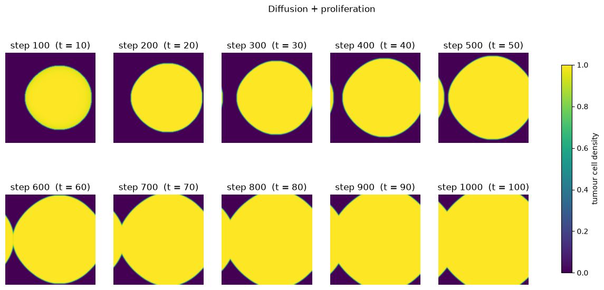 |
| **5 · Tumour (top) and vasculature (bottom)** |
| 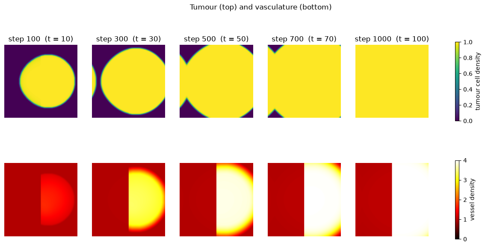 |

<details>
<summary><b>Corrected models 1–3</b></summary>

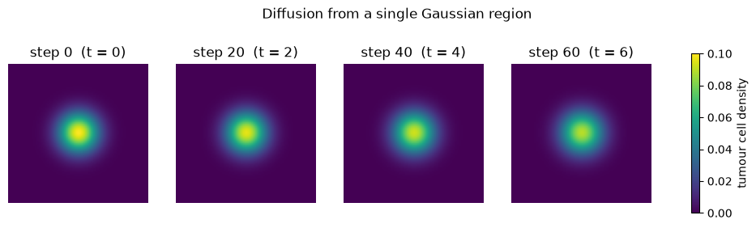
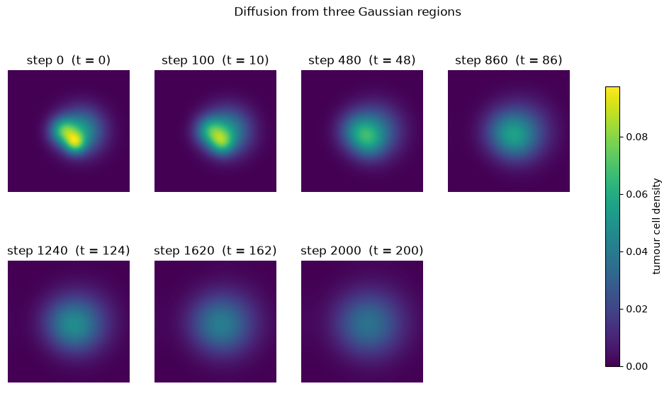
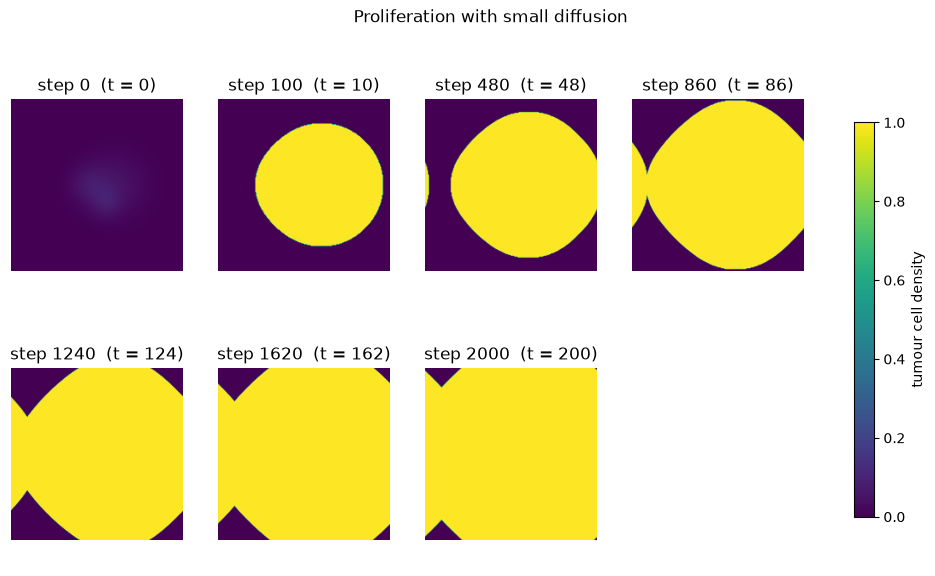

</details>

### Original notebooks

A representative frame from each original notebook. Models 1, 3, 4 and 5 are affected by the issues listed under [Known Issues](#known-issues-in-the-original-notebooks).

|  |  |
|:--:|:--:|
| 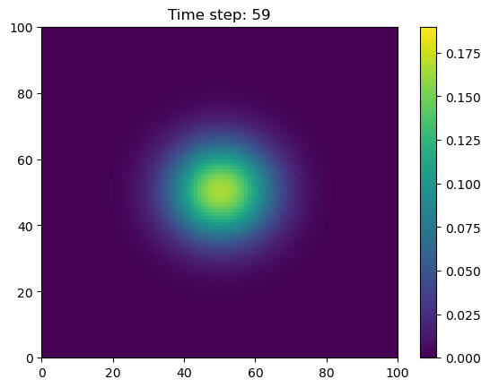 | 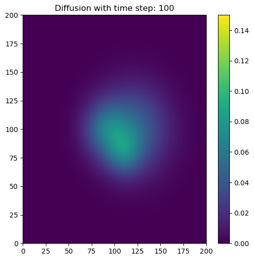 |
| **1 · Diffusion (single region)**<br>Symmetric spread from one Gaussian tumor. | **2 · Diffusion (multiple regions)**<br>Spread from several initial regions. |
|  |  |
| **3 · Proliferation + small diffusion**<br>Dense, slowly spreading tumor. | **4 · Diffusion + proliferation**<br>The tumor grows and fills space. |
| 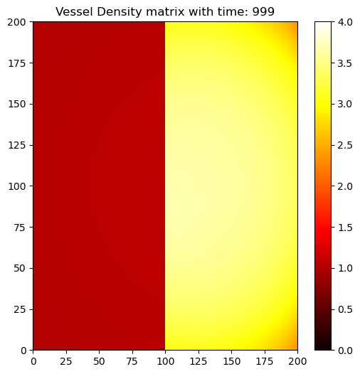 |  |
| **5 · Diffusion + proliferation + irrigation**<br>The vessel-density (vascular) field. |  |

---

## Mathematical Background

**Fisher–Kolmogorov equation** for tumor cell density $n$ (diffusion + logistic proliferation):

$$\frac{\partial n}{\partial t} = D\,\nabla^2 n + \alpha\,n\left(1 - \frac{n}{N_{\max}}\right)$$

where $D$ is the diffusion coefficient, $\alpha$ the proliferation rate, and $N_{\max}$ the carrying capacity.

**Finite-difference discretization** of the Laplacian on the 2D grid (5-point stencil):

$$\nabla^2 n_{i,j} \approx \frac{n_{i+1,j} + n_{i-1,j} + n_{i,j+1} + n_{i,j-1} - 4\,n_{i,j}}{(\Delta x)^2}$$

The equation is stepped forward in time with the explicit (forward Euler) method, which is stable only if $D\,\Delta t/\Delta x^2 \le 1/4$. The boundaries are **periodic**: the grid wraps around, so a tumour that reaches one edge reappears on the opposite edge.

**Vessel coupling (irrigation).** In the final model the vessel density $V$ raises the local proliferation rate, and vessels grow where there are tumour cells. As written in the course notes ([page 7](original/course-notes/07-vessel-model-and-gamma.jpg)):

$$\frac{\partial n}{\partial t} = D\,\nabla^2 n + \big[\alpha_0 + \alpha_1\,(V - 1)^{\Gamma}\big]\, n\left(1 - \frac{n}{N_{\max}}\right)$$

$$\frac{\partial V}{\partial t} = \beta(x)\, n\, V \left(1 - \frac{V}{V_{\max}}\right)$$

$\Gamma$ describes how functional the irrigation is (the notes try 0, 0.5 and 1). $\beta$ is $0.001$ on the left half of the grid and $0.1$ on the right half, which is why the vessel-density images split down the middle.

> The original notebooks do not implement these equations exactly; see [Known Issues](#known-issues-in-the-original-notebooks). The [corrected versions](#corrected-versions) do.

<details>
<summary><b>📄 Original handwritten derivations, course notes &amp; planning</b></summary>

<br>

These are photos of the notebooks I worked from during the summer school, included for anyone who wants to follow the reasoning behind the code. (They are phone photos, so some are rotated.)

| Fisher–Kolmogorov | Discretization | Vessel coupling |
|:--:|:--:|:--:|
| 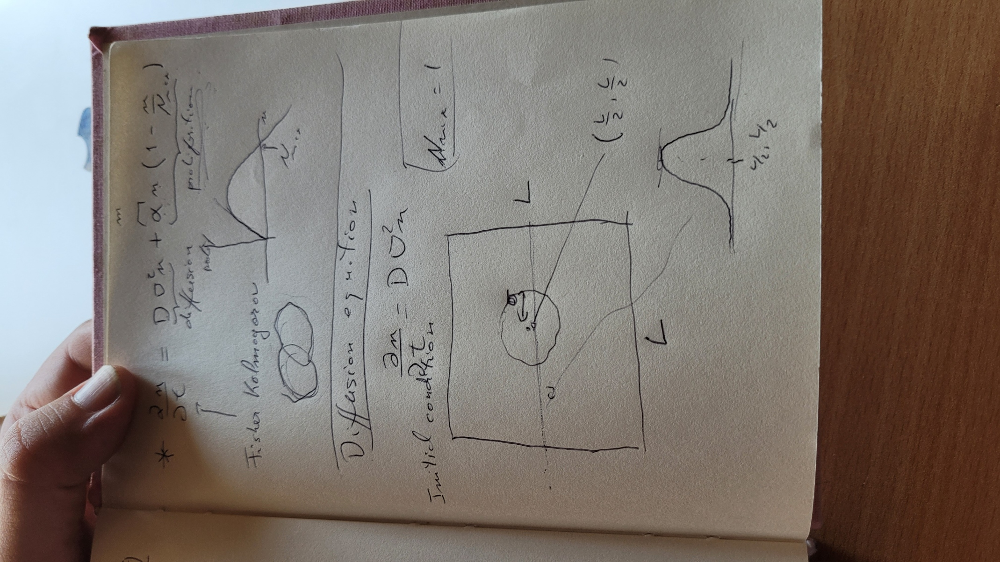 | 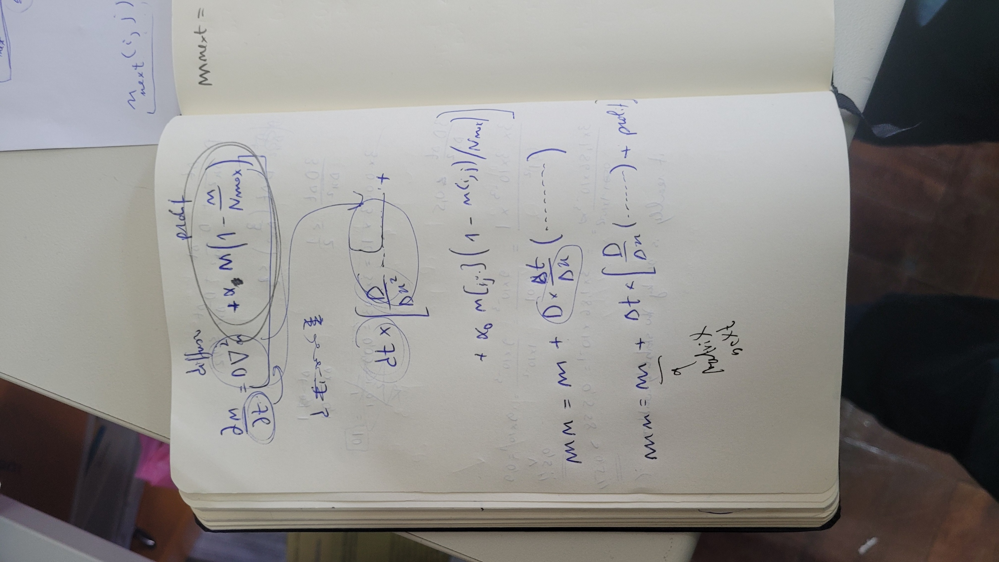 |  |

- Planning sketch: [`original/planning/code-structure.jpg`](original/planning/code-structure.jpg)
- Original unedited photos: [`original/derivations/raw/`](original/derivations/raw/)

**Course notes** ([`original/course-notes/`](original/course-notes/)) are lecture notes from the summer school, in reading order:

| | |
|:--:|:--:|
| <br>1 · Day 2: tumour phases, chemotaxis, haptotaxis, durotaxis | 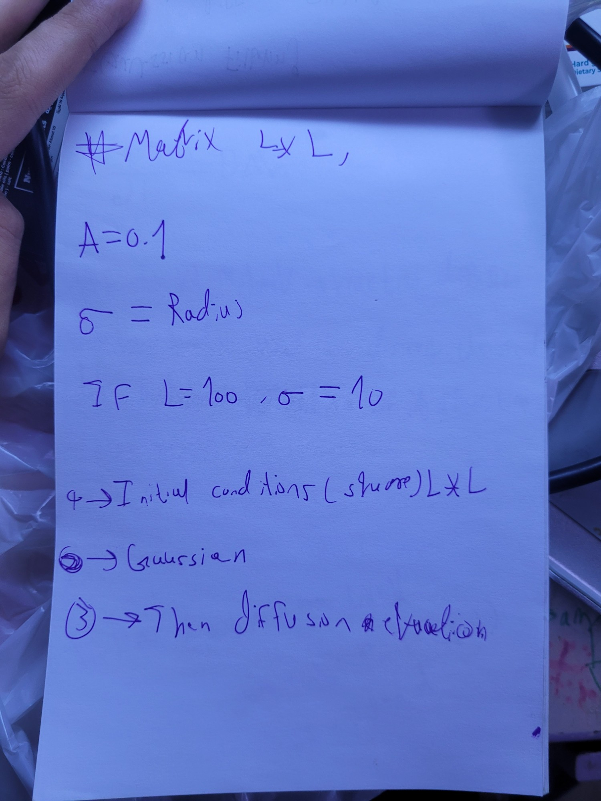<br>2 · Grid and Gaussian initial condition |
| 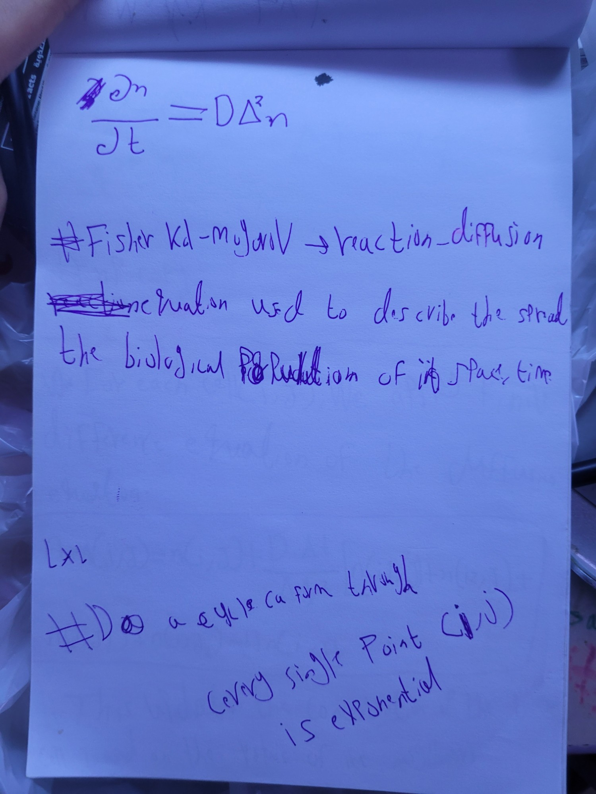<br>3 · Diffusion and Fisher–Kolmogorov | 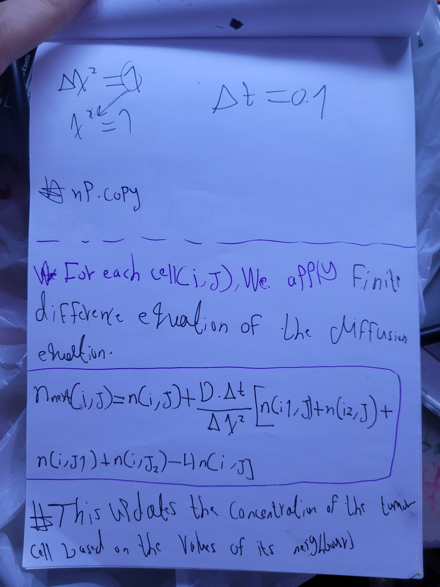<br>4 · Finite-difference update |
| 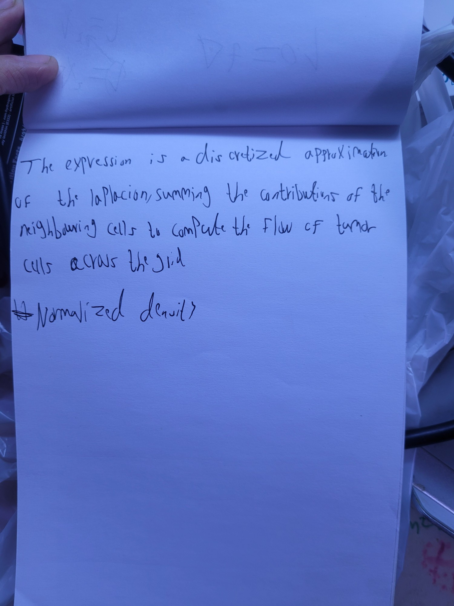<br>5 · What the discrete Laplacian does | 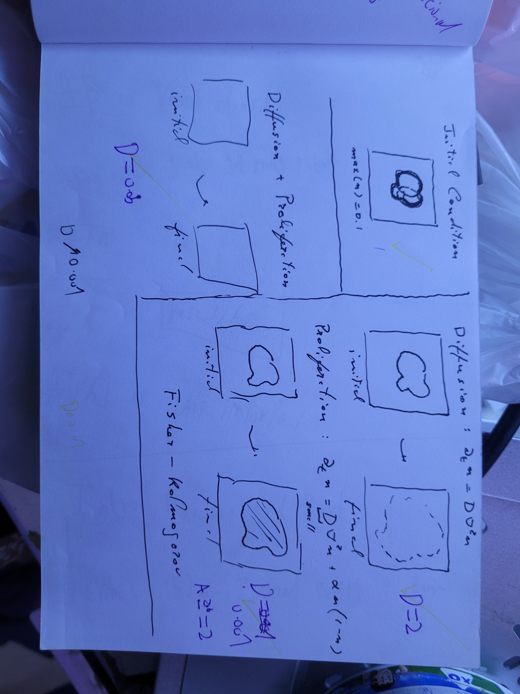<br>6 · Overview of models 1–4 and their parameters |
| 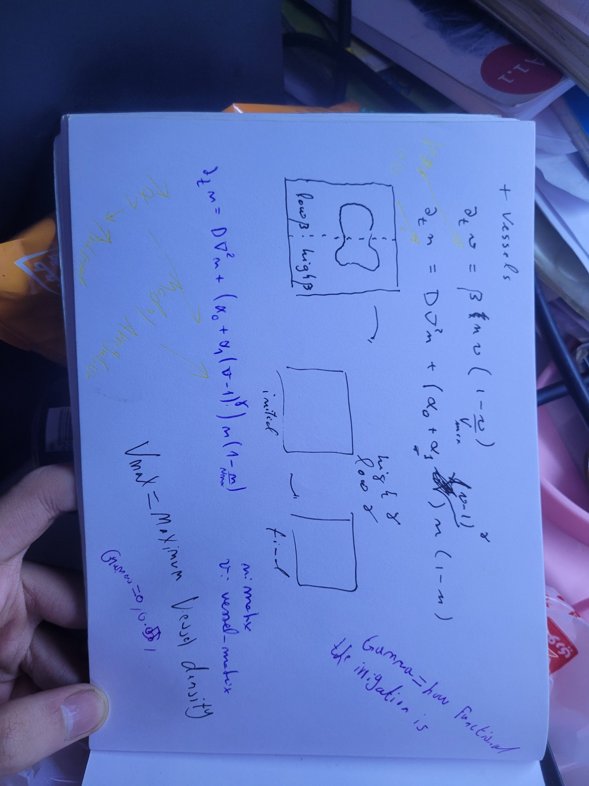<br>7 · Vessel model, β split and the meaning of γ | |

</details>

---

## The Original Models

These are the five original notebooks in [`original/notebooks/`](original/notebooks/). Parameters are listed as they are set in the code; because of the [known issues](#known-issues-in-the-original-notebooks), the effective rates in models 1, 3, 4 and 5 differ from these values.

### 1 · [`01-diffusion-single-region.ipynb`](original/notebooks/01-diffusion-single-region.ipynb)

**Description.** The simplest model in the series, simulating tumor cell diffusion from a smooth, circular region using a Gaussian distribution. Illustrates how tumor cells spread symmetrically from the center.

**Key features**
- **Initial condition:** smooth, circular tumor region.
- **Processes modeled:** tumor cell diffusion across a 100×100 grid.
- **Parameters:** $D = 1$ (diffusion coefficient), $A = 0.1$ (maximum cell density), $\sigma = 10$ (tumor width).
- **Visualization:** symmetric diffusion of the tumor, shown in real time during the simulation.

### 2 · [`02-diffusion-three-regions.ipynb`](original/notebooks/02-diffusion-three-regions.ipynb)

**Description.** Simulates diffusion starting from three distinct tumor regions, each initialized with a separate Gaussian distribution — a more complex growth pattern.

**Key features**
- **Initial condition:** three distinct regions with different widths and locations.
- **Processes modeled:** diffusion of tumor cells across a 200×200 grid.
- **Parameters:** $D = 2$ (higher diffusion for faster spread), $\sigma_1, \sigma_2, \sigma_3$ (region widths), $A = 0.05$ (maximum cell density).
- **Visualization:** tumor growth at multiple time steps (100, 480, 860, …), showing how the regions interact and spread.

### 3 · [`03-proliferation-small-diffusion.ipynb`](original/notebooks/03-proliferation-small-diffusion.ipynb)

**Description.** Introduces **cell proliferation** alongside diffusion, simulating slower cell movement with active growth. Cells grow according to a logistic model, but their movement is restricted by a small diffusion coefficient.

**Key features**
- **Initial condition:** three irregular tumor regions.
- **Processes modeled:** slow diffusion and cell proliferation.
- **Parameters:** $D_1 = 0.001$ (limited diffusion), $\alpha_0 = 2$ (proliferation rate), $N_{\max} = 1$ (carrying capacity).
- **Visualization:** tumor regions proliferate and diffuse slowly, with snapshots at time steps (100, 480, 860, …).

### 4 · [`04-diffusion-proliferation.ipynb`](original/notebooks/04-diffusion-proliferation.ipynb)

**Description.** Balances both **diffusion** and **proliferation**: cells spread moderately while actively multiplying. The tumor grows from three distinct regions.

**Key features**
- **Initial condition:** three tumor regions.
- **Processes modeled:** moderate diffusion and cell proliferation.
- **Parameters:** $D = 0.05$ (moderate diffusion), $\alpha_0 = 1$ (proliferation rate), $N_{\max} = 1$ (carrying capacity).
- **Visualization:** tumor growth at time steps (100, 200, 300, …, 999), showing how diffusion and proliferation interact.

### 5 · [`05-diffusion-proliferation-irrigation.ipynb`](original/notebooks/05-diffusion-proliferation-irrigation.ipynb)

**Description.** The most comprehensive model, incorporating **diffusion**, **proliferation**, and a **vascular network** that supplies nutrients to the growing tumor. Blood vessels grow dynamically in response to the tumor's nutrient demands.

**Key features**
- **Initial condition:** three tumor regions and a uniform vascular network.
- **Processes modeled:** diffusion, proliferation, and irrigation (blood vessel growth).
- **Parameters:** $D = 0.2$ (diffusion coefficient); $\alpha_0 = 1$, $\alpha_1 = 1$, $\Gamma = 0.5$ (proliferation parameters); $V_{\max} = 4$ (maximum vessel density); a **β matrix** controlling vascular growth rate.
- **Visualization:** both the tumor and the vascular network at multiple time steps, showing their interaction.

---

## Corrected Versions

[`corrected/notebooks/`](corrected/notebooks/) contains a corrected version of each original notebook, with the same file names. The originals in [`original/`](original/) are kept unchanged as the record of the summer-school work.

Each corrected notebook:

- implements the equations from [Mathematical Background](#mathematical-background) exactly, with the same parameters, grid and periodic boundaries as the original (notebook 05 uses the vessel equations as written in the course notes);
- runs top to bottom in a fresh kernel and uses NumPy array operations instead of nested Python loops (seconds instead of minutes);
- explains, in a "What changed from the original" note, every difference from the original;
- checks numerical stability, and for the diffusion-only models checks that the total amount of tumour cells is conserved.

One modelling choice is new: in the growth models, densities below `cutoff = 1e-3` in the initial Gaussians are set to zero. A Gaussian never reaches exactly zero, and with logistic growth its 1e-30 tails grow exponentially, so the whole grid fills up within a few hundred steps regardless of where the tumour started.

What the corrected models show:

- **With the growth term fixed, tumours saturate fast.** In model 3 the tumour reaches $N_{\max}$ within about 100 steps; in the original its peak density only rose from 0.10 to 0.14 over 2000 steps.
- **Models 3 and 4 are under-resolved.** The tumour edge is about $\sqrt{D/\alpha_0}$ wide: 0.02 grid cells in model 3 and 0.2 in model 4. When the edge is thinner than a grid cell, how fast the tumour spreads depends on the grid, so use a finer grid for quantitative results.
- **In model 5 the vessels barely affect the tumour.** On the right half the vessels reach $V_{\max}$ by about step 500 and raise the growth rate to about 2.73, yet re-running with $\beta = 0$ changes the tumour area by less than 1 %. The front is pushed by the sparse cells at its leading edge, where no vessels have formed yet ($V = 1$, so $(V - 1)^{\Gamma} = 0$), while behind the front the tumour is already at $N_{\max}$, so a higher growth rate has nothing to act on. For the vasculature to matter, it has to act ahead of the front or limit the tumour, for example through a carrying capacity that depends on $V$. The [extension below](#extension-vessels-set-the-carrying-capacity) does exactly that.

---

## Known Issues in the Original Notebooks

| Notebook | Issue | Effect |
|---|---|---|
| 01 | Diffusion term uses `D * (delta_t/delta_x)` inside an outer `delta_t` | Effective $D = 0.1$ instead of 1 |
| 01 | Contains a logistic growth term | Not a diffusion-only model, as described |
| 02 | Loop uses `num_step` and `matrix_next`, which the notebook never defines | *Restart & Run All* fails with a `NameError`; it only ran with variables left over from another notebook |
| 02 | `range(num_step)` stops at 1999 | The step-2000 snapshot is never drawn |
| 03, 04 | Growth term is inside the `(D / delta_x**2) * (...)` bracket | Growth rate multiplied by $D$: 1000× too slow in 03, 20× in 04 |
| 05 | Same bracket issue, and `(1 - n/N_Max)` also multiplies the diffusion term | Growth multiplied by $D = 0.2$; diffusion switches off where the tumour is dense |
| 05 | Code uses `Alpha_one*(V**Gamma - 1)` and `Beta*n*(1 - V/V_max)`; the course notes write $\alpha_1 (V-1)^{\Gamma}$ and $\beta\, n\, V (1 - V/V_{\max})$ | Smaller growth boost from vessels (1 instead of about 1.73 at $V_{\max}$) and slower vessel growth |
| 02–05 | All save figures as `matrix_step_{time}.png` in the working folder | Notebooks overwrite each other's images (these files are git-ignored) |

The diagnosis was checked by re-implementing notebook 03's update line: it reproduces every maximum density the notebook printed, from 0.0991 to 0.1384.

---

## Extension: Vessels Set the Carrying Capacity

[`corrected/notebooks/06-vessel-dependent-carrying-capacity.ipynb`](corrected/notebooks/06-vessel-dependent-carrying-capacity.ipynb) makes the vasculature matter. Vessels supply a nutrient (e.g. oxygen) that diffuses into the tissue and is consumed by tumour cells, and the local nutrient level sets the carrying capacity. Vessels grow where tumour cells are hypoxic:

$$\frac{\partial c}{\partial t} = D_c\,\nabla^2 c + s\,V\,(1 - c) - \lambda\, n\, c$$

$$\frac{\partial n}{\partial t} = D\,\nabla^2 n + \alpha_0\, n\,\frac{N_{\max}\,c - n}{N_{\max}}$$

$$\frac{\partial V}{\partial t} = \beta(x)\, n\,(1 - c)\left(1 - \frac{V}{V_{\max}}\right)$$

The mechanism follows Rui Travasso's work. In the multiscale model of Jafari Nivlouei, Soltani, Carvalho, Travasso, Salimpour & Shirani (2021, [doi:10.1371/journal.pcbi.1009081](https://doi.org/10.1371/journal.pcbi.1009081)):
- vessels release nutrients that diffuse into the tissue and are consumed by the cells;
- nutrient-starved cells become hypoxic, stop proliferating and form a necrotic core;
- hypoxic cells secrete VEGF, which recruits new vessels.

In Travasso et al. (2011, [doi:10.1371/journal.pone.0019989](https://doi.org/10.1371/journal.pone.0019989)), hypoxic cells release angiogenic factor until oxygen reaches them. Those are cell-based and phase-field models; the continuum equations above are a simplification of that mechanism, not equations from the papers.

**Result.** Angiogenesis is blocked on the left half ($\beta = 0$) and active on the right ($\beta = 0.5$).
- Once the tumour outgrows the nutrient's reach, its core becomes hypoxic and dies back.
- Where vessels form, the tumour settles at a mean density of **0.45**, against **0.27** where angiogenesis is blocked and in a control run with no angiogenesis anywhere.

| Tumour (top), nutrient = carrying capacity (middle), vessels (bottom) |
|:--:|
| 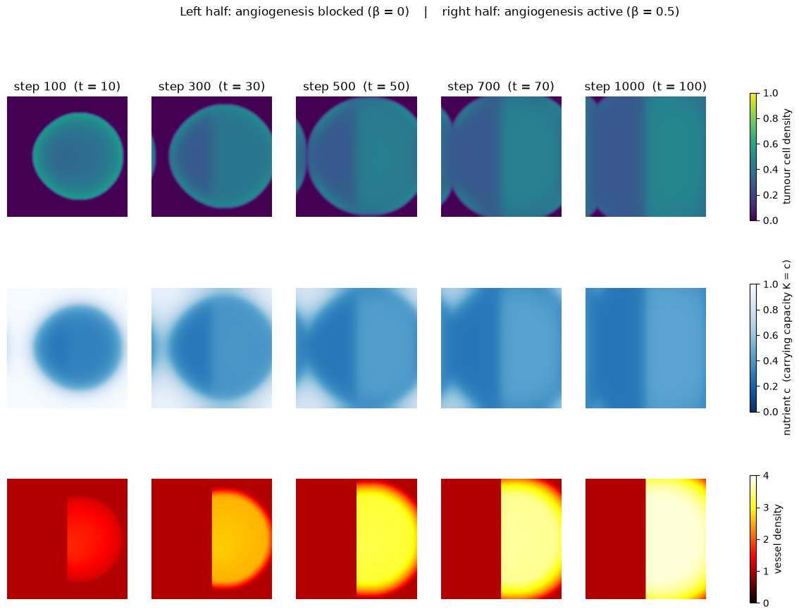 |
| 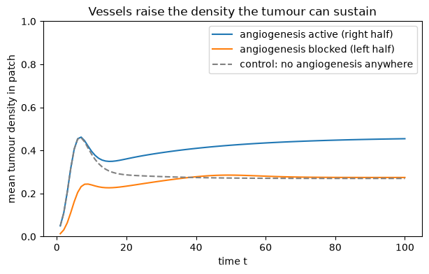 |

Parameters are in grid units and chosen for illustration, not calibrated to tissue.

---

## Installation

```bash
git clone https://github.com/SamDozer/2D-Tumor-Angiogenesis-Simulation.git
cd 2D-Tumor-Angiogenesis-Simulation
pip install -r requirements.txt
```

**Requirements:** Python 3.x, Jupyter Notebook, and the libraries `numpy` and `matplotlib` (installed by the command above).

---

## How to Run

Launch Jupyter and open a notebook from `corrected/notebooks/` or `original/notebooks/`:

```bash
jupyter notebook
```

Run the cells top to bottom (**Kernel → Restart & Run All**). The corrected notebooks are self-contained and run in seconds. The originals are slow (nested Python loops), and the original notebook 02 only runs after another notebook has defined `num_step` and `matrix_next` (see [Known Issues](#known-issues-in-the-original-notebooks)).

To regenerate the gallery images from the notebooks' saved outputs:

```bash
python corrected/scripts/extract_results.py
```

---

## Acknowledgments

This project was completed under the guidance of Professor Rui Travasso and Matilda Palmeira. I am deeply grateful for their support and insights, which enabled me to complete this project in under a week. This work was part of the Computational Biology Summer School in Coimbra in September 2024, and it also marks my first Python project. I'm proud to present this work and look forward to exploring more projects in computational biology and neuroscience in the future.

---

## License

Released under the [MIT License](LICENSE).
