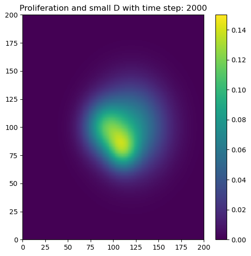
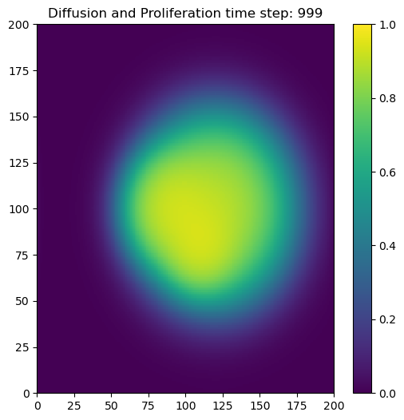
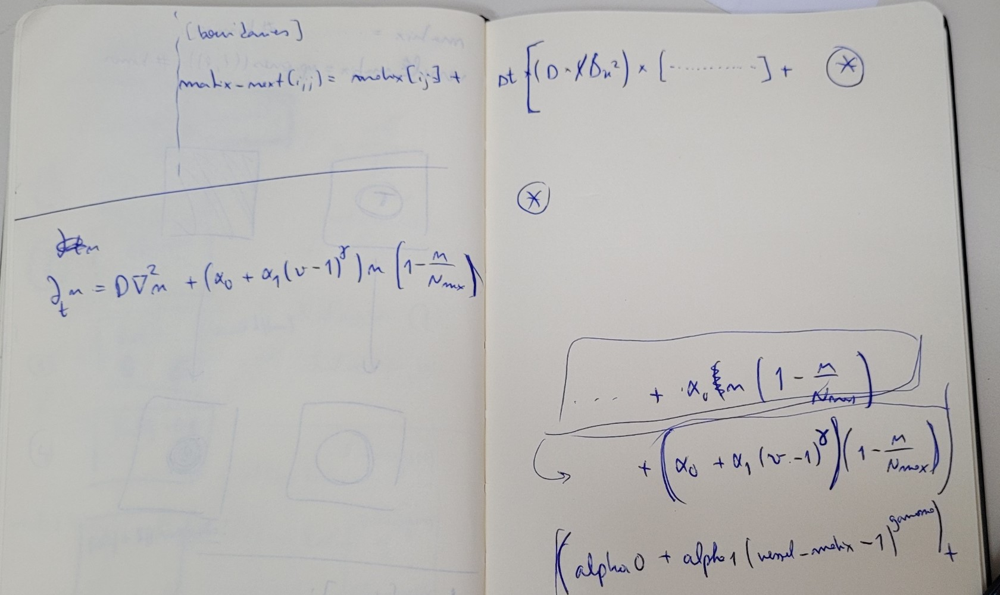

# 🧬 2D Tumor Angiogenesis Simulation


> A series of 2D models simulating tumor angiogenesis — how tumor cells diffuse,
> proliferate, and recruit a vascular network for nutrient supply — implemented in
> Python with NumPy and Matplotlib using the finite-difference method.

This repository contains a series of 2D models simulating tumor angiogenesis, focusing on how tumor cells diffuse, proliferate, and interact with a vascular network for nutrient supply. The models are implemented on a 2D grid, using simplified mathematical representations of biological processes. While the models explore various levels of complexity—ranging from basic diffusion to dynamic blood vessel growth—they remain simplified approximations of real-life tumor behavior and do not aim to be fully 3D or exhaustive in biological realism.

The simulations use Python and Jupyter Notebooks, employing the finite difference method to solve the diffusion and proliferation equations that govern tumor growth. Additionally, blood vessel growth (irrigation) is modeled to simulate how vessels dynamically develop to supply nutrients to the tumor. These models serve as educational tools for understanding basic angiogenesis processes in a 2D framework.

---

## Table of Contents

- [Overview](#overview)
- [Repository Structure](#repository-structure)
- [Results Gallery](#results-gallery)
- [Mathematical Background](#mathematical-background)
- [The Models](#the-models)
- [Installation](#installation)
- [How to Run](#how-to-run)
- [Acknowledgments](#acknowledgments)
- [License](#license)

---

## Overview

Tumor angiogenesis is crucial for tumor expansion, as the process allows the tumor to grow beyond a size where diffusion alone can sustain it. This process involves inducing the growth of new blood vessels to supply nutrients and oxygen to the tumor. This repository provides models that simulate this process starting with basic diffusion and adding more biological complexity, such as cell proliferation and dynamic blood vessel growth.

The main equations used in the models include:

- **Fisher–Kolmogorov equation** — models tumor cell **diffusion** and **proliferation**, combining diffusion (the Laplacian operator $\nabla^2 n$) with logistic growth.
- **Vessel growth equation** — models the growth of blood vessels as a function of tumor cell density and vessel density, regulating how the vascular network adapts to supply the growing tumor.
- **Gaussian initialization** — tumor cells are initially placed in Gaussian-shaped regions, simulating circular or irregular initial tumor shapes.
- **Finite difference method** — used to discretize the spatial derivatives (the Laplacian) and solve the partial differential equations governing tumor growth and vascular formation.

Each notebook explores a different aspect of tumor angiogenesis:

- **Diffusion** — tumor cells spread across space due to concentration gradients.
- **Proliferation** — tumor cells multiply based on local cell density, following logistic growth.
- **Irrigation** — blood vessels grow dynamically to supply the tumor with nutrients.

---

## Repository Structure

```
2D-Tumor-Angiogenesis-Simulation/
├── README.md
├── LICENSE
├── requirements.txt
├── .gitignore
├── notebooks/                          # the five models, in order of increasing complexity
│   ├── 01-diffusion-single-region.ipynb
│   ├── 02-diffusion-three-regions.ipynb
│   ├── 03-proliferation-small-diffusion.ipynb
│   ├── 04-diffusion-proliferation.ipynb
│   └── 05-diffusion-proliferation-irrigation.ipynb
├── scripts/
│   └── extract_results.py              # regenerates the gallery images from notebook outputs
└── docs/
    ├── notes.docx                      # working notes
    ├── results/                        # exported figures used in the gallery below
    ├── derivations/                    # handwritten model derivations
    │   └── raw/                        # original unedited photos
    ├── planning/                       # code-structure planning sketch
    └── presentation/                   # summer-school project slides
```

---

## Results Gallery

A representative frame from each model (regenerate with `python scripts/extract_results.py`):

|  |  |
|:--:|:--:|
|  |  |
| **1 · Diffusion (single region)**<br>Symmetric spread from one Gaussian tumor. | **2 · Diffusion (multiple regions)**<br>Spread from several initial regions. |
|  |  |
| **3 · Proliferation + small diffusion**<br>Dense, slowly spreading tumor. | **4 · Diffusion + proliferation**<br>The tumor grows and fills space. |
|  |  |
| **5 · Diffusion + proliferation + irrigation**<br>The vessel-density (vascular) field. |  |

---

## Mathematical Background

**Fisher–Kolmogorov equation** for tumor cell density $n$ (diffusion + logistic proliferation):

$$\frac{\partial n}{\partial t} = D\,\nabla^2 n + \alpha\,n\left(1 - \frac{n}{N_{\max}}\right)$$

where $D$ is the diffusion coefficient, $\alpha$ the proliferation rate, and $N_{\max}$ the carrying capacity.

**Finite-difference discretization** of the Laplacian on the 2D grid (5-point stencil):

$$\nabla^2 n_{i,j} \approx \frac{n_{i+1,j} + n_{i-1,j} + n_{i,j+1} + n_{i,j-1} - 4\,n_{i,j}}{(\Delta x)^2}$$

The equation is then stepped forward in time explicitly, with no-flux behavior enforced at the grid boundaries.

**Vessel coupling (irrigation).** In the final model, the vessel density $v$ evolves by a separate growth equation driven by the local tumor cell density and the existing vessel density, regulated by a maximum vessel capacity $V_{\max}$ and a growth-rate ($\beta$) matrix. The tumor and vasculature are updated together each time step so the vascular network adapts to the tumor's nutrient demand.

<details>
<summary><b>📄 Original handwritten derivations &amp; planning notes</b></summary>

<br>

These are photos of the notebook I worked from during the summer school, included for anyone who wants to follow the reasoning behind the code. (They are phone photos, so some are rotated.)

| Fisher–Kolmogorov | Discretization | Vessel coupling |
|:--:|:--:|:--:|
|  |  |  |

- Planning sketch: [`docs/planning/code-structure.jpg`](docs/planning/code-structure.jpg)
- Original unedited photos: [`docs/derivations/raw/`](docs/derivations/raw/)

</details>

---

## The Models

### 1 · [`notebooks/01-diffusion-single-region.ipynb`](notebooks/01-diffusion-single-region.ipynb)

**Description.** The simplest model in the series, simulating tumor cell diffusion from a smooth, circular region using a Gaussian distribution. Illustrates how tumor cells spread symmetrically from the center.

**Key features**
- **Initial condition:** smooth, circular tumor region.
- **Processes modeled:** tumor cell diffusion across a 100×100 grid.
- **Parameters:** $D = 1$ (diffusion coefficient), $A = 0.1$ (maximum cell density), $\sigma = 10$ (tumor width).
- **Visualization:** symmetric diffusion of the tumor, shown in real time during the simulation.

### 2 · [`notebooks/02-diffusion-three-regions.ipynb`](notebooks/02-diffusion-three-regions.ipynb)

**Description.** Simulates diffusion starting from three distinct tumor regions, each initialized with a separate Gaussian distribution — a more complex growth pattern.

**Key features**
- **Initial condition:** three distinct regions with different widths and locations.
- **Processes modeled:** diffusion of tumor cells across a 200×200 grid.
- **Parameters:** $D = 2$ (higher diffusion for faster spread), $\sigma_1, \sigma_2, \sigma_3$ (region widths), $A = 0.05$ (maximum cell density).
- **Visualization:** tumor growth at multiple time steps (100, 480, 860, …), showing how the regions interact and spread.

### 3 · [`notebooks/03-proliferation-small-diffusion.ipynb`](notebooks/03-proliferation-small-diffusion.ipynb)

**Description.** Introduces **cell proliferation** alongside diffusion, simulating slower cell movement with active growth. Cells grow according to a logistic model, but their movement is restricted by a small diffusion coefficient.

**Key features**
- **Initial condition:** three irregular tumor regions.
- **Processes modeled:** slow diffusion and cell proliferation.
- **Parameters:** $D_1 = 0.001$ (limited diffusion), $\alpha_0 = 2$ (proliferation rate), $N_{\max} = 1$ (carrying capacity).
- **Visualization:** tumor regions proliferate and diffuse slowly, with snapshots at time steps (100, 480, 860, …).

### 4 · [`notebooks/04-diffusion-proliferation.ipynb`](notebooks/04-diffusion-proliferation.ipynb)

**Description.** Balances both **diffusion** and **proliferation**: cells spread moderately while actively multiplying. The tumor grows from three distinct regions.

**Key features**
- **Initial condition:** three tumor regions.
- **Processes modeled:** moderate diffusion and cell proliferation.
- **Parameters:** $D = 0.05$ (moderate diffusion), $\alpha_0 = 1$ (proliferation rate), $N_{\max} = 1$ (carrying capacity).
- **Visualization:** tumor growth at time steps (100, 200, 300, …, 999), showing how diffusion and proliferation interact.

### 5 · [`notebooks/05-diffusion-proliferation-irrigation.ipynb`](notebooks/05-diffusion-proliferation-irrigation.ipynb)

**Description.** The most comprehensive model, incorporating **diffusion**, **proliferation**, and a **vascular network** that supplies nutrients to the growing tumor. Blood vessels grow dynamically in response to the tumor's nutrient demands.

**Key features**
- **Initial condition:** three tumor regions and a uniform vascular network.
- **Processes modeled:** diffusion, proliferation, and irrigation (blood vessel growth).
- **Parameters:** $D = 0.2$ (diffusion coefficient); $\alpha_0 = 1$, $\alpha_1 = 1$, $\Gamma = 0.5$ (proliferation parameters); $V_{\max} = 4$ (maximum vessel density); a **β matrix** controlling vascular growth rate.
- **Visualization:** both the tumor and the vascular network at multiple time steps, showing their interaction.

---

## Installation

```bash
git clone https://github.com/SamDozer/2D-Tumor-Angiogenesis-Simulation.git
cd 2D-Tumor-Angiogenesis-Simulation
pip install -r requirements.txt
```

**Requirements:** Python 3.x, Jupyter Notebook, and the libraries `numpy` and `matplotlib` (installed by the command above).

---

## How to Run

Launch Jupyter and open any notebook in the `notebooks/` folder:

```bash
jupyter notebook
```

Run the cells top to bottom (**Kernel → Restart & Run All**). Each notebook is self-contained and produces its visualizations inline.

To regenerate the images in `docs/results/` from the notebooks' saved outputs:

```bash
python scripts/extract_results.py
```

---

## Acknowledgments

This project was completed under the guidance of Professor Rui Travasso and Matilda Palmeira. I am deeply grateful for their support and insights, which enabled me to complete this project in under a week. This work was part of the Computational Biology Summer School in Coimbra in September 2024, and it also marks my first Python project. I'm proud to present this work and look forward to exploring more projects in computational biology and neuroscience in the future.

---

## License

Released under the [MIT License](LICENSE).
